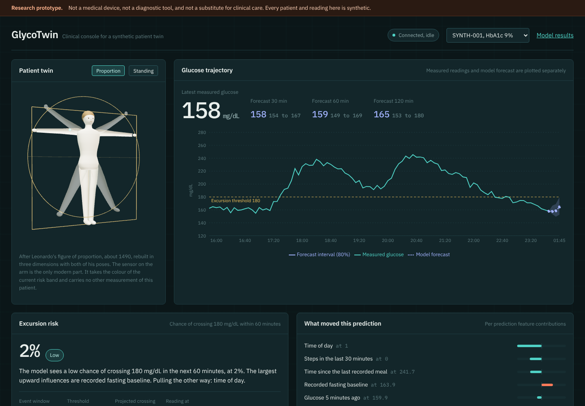
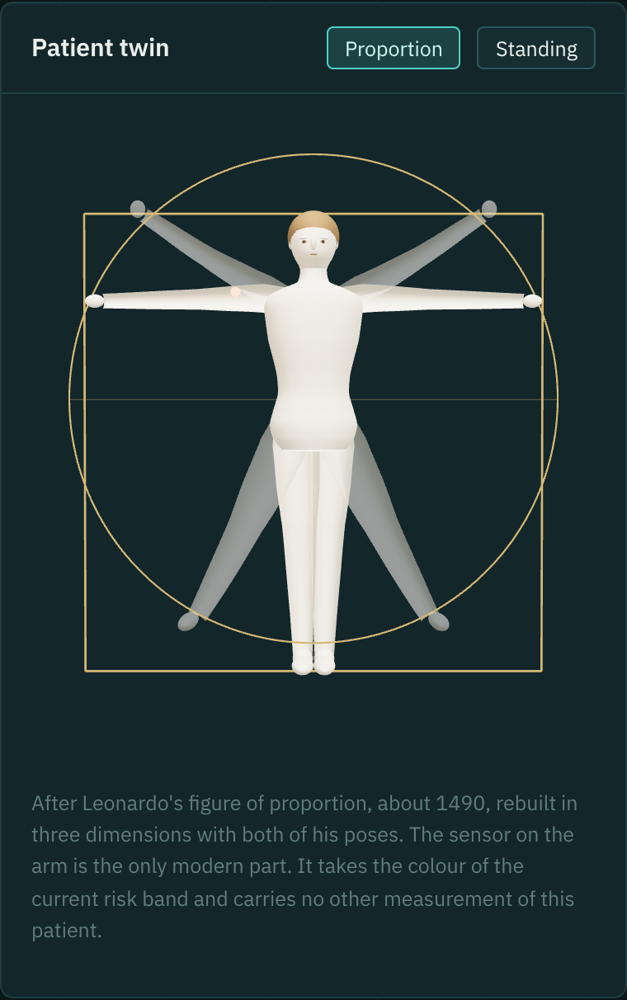
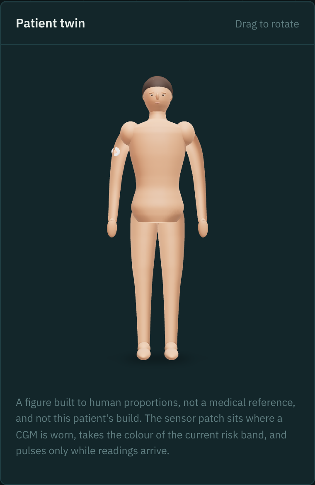

# GlycoTwin

An evolving patient digital twin that forecasts glucose and flags possible
excursions for Type 2 diabetes, with a clinician facing console.

**This is a research proof of concept. It is not a medical device, not a
diagnostic tool, and not a substitute for clinical care. Every patient and
reading in it is synthetic. It produces no medication or dosing guidance
anywhere.**

Built to the brief in `competition.txt`. Section references below point at the
part of that brief a decision comes from.

## Team

> **Fill this in before submitting.** The brief asks for team information under
> deliverable 10, and it is the one thing here that cannot be derived from the
> work. Rename the repository to `GlycoTwin_TeamName_CollegeName` as section 17
> suggests.

| Name | Role | Contact |
| --- | --- | --- |
|  | AI and ML: dataset, features, training, evaluation |  |
|  | Backend and data: ingestion, API, twin state, streaming |  |
|  | Frontend: console, visualisation, replay, scenarios |  |
|  | Research and integration: clinical framing, documentation, submission |  |

College:

---

## What it does

A sensor event arrives. The twin validates it, updates a rolling feature
window, recomputes a glucose forecast at 30, 60 and 120 minutes with an
uncertainty band, estimates the probability of crossing 180 mg/dL within the
next hour, records what drove that estimate, and pushes the result to the
console over a WebSocket. Every prediction is stored with its timestamp, model
version, uncertainty and data quality status (brief sections 5.3 and 7).

Headline result on patients the model never saw during training:

| Horizon | MAE | RMSE | Persistence baseline MAE | Gain |
| --- | --- | --- | --- | --- |
| 30 min | 6.27 | 8.44 | 10.65 | 41.1% |
| 60 min | 11.44 | 16.47 | 17.27 | 33.7% |
| 120 min | 16.12 | 22.23 | 24.88 | 35.2% |

Excursion detection on the same held out patients: PR-AUC 0.762, precision
0.795, recall 0.559, specificity 0.981, expected calibration error 0.018, at an
operating threshold of 0.34 chosen on validation patients. The slope
extrapolation baseline reaches PR-AUC 0.424 on the same rows.

Full numbers, including per patient spread, calibration bins and the
chronological holdout, are in `evaluation/evaluation-report.md`, generated from
`evaluation/metrics.json`. Nothing in either file is typed by hand.

---



## Run it

### With Docker

The cohort and the models are produced outside the image so the evaluation
stays reproducible and the image stays small. Generate them once, then bring
the stack up:

```bash
pip install -r requirements.txt
python data/generator/generate_cohort.py      # writes data/
python -m ml.train                            # writes model_artifacts/ and evaluation/

docker compose up --build
```

- Console: http://localhost:3000
- API and interactive docs: http://localhost:8000/docs

Compose starts Postgres, the FastAPI twin service and the Next.js console. The
API waits for the database, seeds the synthetic patients on first start, and
primes every twin with a warm window so the console opens on real data rather
than an empty chart.

### Without Docker

The backend falls back to a local SQLite file when no database URL is set, so
Postgres is optional for development.

```bash
pip install -r requirements.txt
python data/generator/generate_cohort.py
python -m ml.train
uvicorn backend.app.main:app --reload --port 8000

cd frontend && npm install
NEXT_PUBLIC_API_BASE=http://localhost:8000 npm run dev
```

### Driving the stream

From the console, use **Replay recorded data** or **Simulate live sensor**, set
a speed, and pause or restart at any time. From outside the process:

```bash
python simulator/replay_stream.py --patient SYNTH-004 --limit 200
python simulator/generate_stream.py --patient SYNTH-006 --defect-rate 0.2
```

Replay sends the recorded synthetic series in timestamp order with its injected
defects. Simulate perturbs values and injects invalid, missing, duplicate and
late readings so the validation path and the data quality panel can be seen
working.

---

## Clinical target definition

Fixed before training, after inspecting the generated cohort (brief section 13,
stage 1).

**Threshold: 180 mg/dL.** The upper bound of the 70 to 180 mg/dL time in range
band used in CGM consensus reporting. The generated cohort spends 19.8% of
readings above it, frequent enough to learn and rare enough to be worth
predicting.

**Forecast horizons: 30, 60 and 120 minutes**, as the brief specifies in
section 4.

**Event horizon: 60 minutes.** The event is "does any reading in the next 60
minutes exceed 180 mg/dL".

**Scored population: readings currently at or below 180 mg/dL.** This is the
decision that most affects the reported numbers. Scoring every reading would
include ones already above the threshold, where the answer is close to trivial
and the metrics flatter the model. Restricting to readings below it makes the
task a genuine crossing prediction. Event rate on that population is 11.8% in
the test split.

**Uncertainty: an 80% interval** from quantile regression at 0.10 and 0.90,
widened by conformal calibration fitted on validation patients.

**Low glucose is not predicted.** The cohort holds too few readings below
70 mg/dL to support a hypoglycaemia model, so none was trained. The brief
treats this as an optional secondary target (section 4).

---

## How it is evaluated

Two protocols, both reported (brief section 6.3):

1. **Patient level holdout, primary.** 40 patients split 26 train, 6
   validation, 8 test. Test patients appear in no part of training, early
   stopping, calibration or threshold selection.
2. **Chronological holdout, secondary.** Models retrained on the training
   patients excluding the final 3 days, then scored on those days, so no future
   reading can leak backwards.

Adjacent readings from one patient never land on both sides of a split, which
the brief warns produces misleadingly strong results. Both protocols agree,
which suggests the gain over persistence is not an artefact of one way of
splitting.

Baselines scored on identical rows: **persistence** (future glucose equals the
latest reading) and **ridge regression** for forecasting, and **slope
extrapolation** for the event. Persistence matters most here because glucose is
strongly autocorrelated, so a model that cannot beat it is not doing anything.

Feature construction is restricted to information available at the prediction
timestamp. Training and serving call the same `ml/feature_engineering.py`, so
the two cannot drift apart.

---

## Architecture

```
Synthetic EHR  ─┐
Synthetic CGM  ─┼─►  Ingestion and validation  ─►  Feature and twin state  ─►  Prediction service
Wearable data  ─┘      (units, ranges,              (rolling window,            (LightGBM forecasters,
                        duplicates, gaps,            latest state,               quantile intervals,
                        late arrival)                trend, quality)             calibrated classifier)
                                                            │                            │
                                                            ▼                            ▼
                                                      PostgreSQL  ◄──────────  predictions, observations
                                                            │
                                                            ▼
                                              FastAPI  ──WebSocket──►  Next.js console
```

The six components the brief names in section 11, as they map to the code:

| Component | Where |
| --- | --- |
| Data sources | `data/generator/` |
| Ingestion and validation | `ml/preprocessing.py`, `backend/app/services/twin_state.py` |
| Feature and twin state service | `ml/feature_engineering.py`, `backend/app/services/twin_state.py` |
| Prediction service | `ml/train.py`, `backend/app/services/model_service.py` |
| Persistence | `backend/app/models/tables.py` |
| Console | `frontend/` |

A diagram for submission is in `architecture/` as PDF and PNG.

### Stack

Next.js 15 and TypeScript, Recharts, React Three Fiber for the 3D figure,
FastAPI, LightGBM and scikit-learn, pandas and NumPy, PostgreSQL, WebSockets,
Docker Compose. No Kafka, no Kubernetes, no microservice fan out, which the
brief explicitly warns against in section 10.

---

## The console

The first screen carries the patient twin, the live trajectory, the risk
estimate and what drove it. Measured readings and model output are drawn as two
separate series in two colours, which section 8 of the brief requires.

Panels: patient overview, live trajectory with uncertainty band, excursion risk
with a plain language explanation, per prediction feature contributions, the
alert threshold control described below, stream controls, data quality,
hypothetical scenarios, prediction history, and a twin timeline pairing past
forecasts with what was later measured. `/results` shows
the full evaluation, read from the API.

The 3D figure is schematic, not anatomy. The sensor patch and platform take the
colour of the current risk band and pulse only while readings are arriving, so
it never says something the numbers do not.

### Hypothetical scenarios

Four scenarios re-run the model on a modified recent window: a brisk walk,
a lighter last meal, a later last meal, more sleep. Results are labelled
hypothetical everywhere they appear.

Two guards sit on this feature. Scenario magnitudes stay inside the ranges the
cohort contains, and each modified input is checked against the
training distribution and reported as within range, extreme, or outside the
training range. Gradient boosted trees do not extrapolate, so an input pushed
past the largest split the model learned produces a number that stops responding
and means nothing. The console shows that check rather than hiding it.

The effects are small, usually a few mg/dL, because recent glucose history
dominates these models. That is the honest result and it is shown as measured.

---

### The 3D figure

The twin is built in code, not loaded from an asset. Elliptical cross sections
are lofted into a continuous surface, limbs are tapered tubes along curves, and
it is lit with an image based environment generated in the browser from three's
RoomEnvironment, so nothing is fetched at runtime. Proportions follow the usual
drawing canon of roughly seven and a half head heights.

It is built rather than downloaded for a licensing reason: ready made human
models generally carry terms that would conflict with shipping this repository
under MIT.

Two views, switched in the panel header:

**Proportion**, the default, is a reading of Leonardo's figure of proportion
from about 1490, rebuilt in three dimensions. Both poses he superimposed are
present, one held back behind the other, with the level pose touching the square
and the raised pose touching the circle. The drawing is centuries out of
copyright, so this is a reinterpretation rather than a reproduction of the
sheet. It rocks slowly instead of spinning, because a diagram wants to be read
face on. It suits the subject: a figure about human measurement, standing over a
system that measures a human.

**Standing** is the plain anatomical figure, with the sensor where a CGM is
worn in practice. It is the better view for explaining sensor placement.

Neither figure encodes anything about the patient except the risk colour on the
sensor, and the caption in the panel says so. Append `?still` to the URL to stop
the motion, which is how the screenshots here were taken.





## Choosing the alert threshold

The training run picks a default operating point by F1 on validation patients.
That is a statistical default, not a clinical judgement about whether a missed
crossing or a false alarm is worse, so the console exposes the choice.

The **Alert threshold** panel shows what moving the line costs, measured on the
held out patients. Burden is reported as alert *episodes*: readings arrive every
5 minutes, so one rising episode trips the threshold repeatedly, and counting
each firing separately overstates what reaches a clinician by roughly six times.
Consecutive firings within 60 minutes are counted once.

| Threshold | Crossings caught | Alert episodes per patient per day | True alerts | Median warning |
| --- | --- | --- | --- | --- |
| 0.10 | 87.7% | 7.8 | 40.8% | 25 min |
| 0.20 | 68.4% | 4.8 | 59.6% | 25 min |
| 0.35 (nearest the 0.34 default) | 55.9% | 3.5 | 73.5% | 25 min |
| 0.50 | 50.1% | 3.1 | 80.0% | 30 min |
| 0.80 | 35.7% | 2.2 | 93.0% | 25 min |

Moving the slider changes which predictions are flagged and how the risk band
reads. It does not change the probability the model produced, and it does not
retrain or recalibrate anything. The change lasts for the life of the process
and is not written to the database. `GET` and `PUT /api/operating-point` do the
same thing over the API.

Median warning time sits near 25 minutes across most of the range, so a lower
threshold buys more caught crossings rather than earlier ones.

---

## Limitations

Read these before reading any number above.

1. **The data is synthetic.** Every metric measures how well the models recover
   a simulator written for this project, not human physiology. Performance here
   predicts nothing about performance on real CGM data.

2. **No claim is made about Indian Type 2 patients.** The brief notes in
   section 12.2 that OhioT1DM is Type 1 data and cannot establish validity for
   Indian Type 2 patients. This project does not use OhioT1DM, and its synthetic
   cohort establishes even less. There has been no prospective validation, no
   clinical review, and no evaluation on any real population.

3. **Prediction intervals under cover.** The nominal 80% interval covers 76.5%,
   75.8% and 74.9% at 30, 60 and 120 minutes on held out patients. Conformal
   calibration improved this from 69.0%, 65.4% and 65.2%, but does not close the
   gap, because a previously unseen patient breaks the exchangeability
   assumption the conformal guarantee rests on. Intervals shown in the console
   are therefore narrower than they should be.

4. **Recall is moderate at the default threshold.** It catches 55.9% of
   crossings, so roughly four in nine are missed. This is adjustable, and the
   console shows the measured cost of moving it, but no setting is free: 87.7%
   recall comes with 7.8 alert episodes per patient per day, of which about 59%
   are false. Nobody has yet asked a clinician where that line belongs, which is
   the open question rather than a solved one.

5. **Synthetic EHR demonstrates integration, nothing more.** Profiles are used
   as model features and shown in the console. They are not realistic clinical
   records and the cohort is not a realistic case mix.

6. **Scenario comparisons are associations.** The models learned from a
   generator in which activity and time of day move together, so the response
   to an activity change reflects that association rather than an isolated
   effect of exercise. Changing an input and seeing a different forecast is not
   evidence that the change would cause that outcome in a patient.

7. **No hypoglycaemia prediction**, as described under the clinical target.

8. **Time to threshold is read off the forecast curve** by interpolation, not
   produced by a time to event model. It is an estimate.

9. **No automated test suite.** Verification was manual. The pipeline was run
   end to end, streaming and validation were exercised with deliberately
   injected defects, and live forecast error was compared against the offline
   evaluation as a consistency check. Replaying held out patient SYNTH-013
   through the running API produced a live MAE of 6.07 mg/dL at 30 minutes over
   194 scored forecasts, against 6.27 mg/dL offline on the full test set. At 60
   minutes the live figure was 8.14 mg/dL against 10.02 mg/dL offline for that
   same patient, the live run covering an earlier and quieter stretch of the
   series rather than all 14 days. The running system and the evaluation agree,
   which is what this check is for.

---

## Privacy and safety

No real or identifiable data is used, stored or required. No credentials or
tokens are committed. The console shows a persistent banner stating what the
system is not. It produces no medication or dosing guidance, flags missing,
stale, invalid and late data rather than filling gaps with invented values, and
labels every hypothetical as hypothetical. Rejected readings are counted and
surfaced, never silently imputed (brief section 15).

---

## Repository layout

```
glycotwin/
├── data/
│   ├── generator/generate_cohort.py   synthetic cohort generator
│   └── README.md                      what is modelled and what is not
├── ml/
│   ├── config.py                      thresholds, horizons, split sizes
│   ├── preprocessing.py               validation and cleaning
│   ├── feature_engineering.py         temporal features, shared with serving
│   ├── train.py                       training, baselines, both protocols
│   └── evaluate.py                    metric computation
├── backend/app/
│   ├── main.py                        app, startup, twin priming
│   ├── api/                           REST routes and WebSocket
│   ├── services/                      twin state, model service, engine
│   └── models/                        ORM tables and API schemas
├── frontend/                          Next.js console
├── simulator/                         external replay and defect generators
├── evaluation/                        metrics.json and generated report
├── architecture/                      diagram, PDF and PNG
├── presentation/                      slide deck, PDF
└── demo/walkthrough.md                what to show, in order
```

## Reproducing from scratch

```bash
pip install -r requirements.txt
python data/generator/generate_cohort.py --seed 20261023
python -m ml.train
python scripts/write_evaluation_report.py
```

The generator and the split are seeded, so the figures above reproduce exactly.
Training takes about 75 seconds on a laptop CPU.

## Licence

MIT, see `LICENSE`. All data is generated by code in this repository, so no
dataset licence applies.
